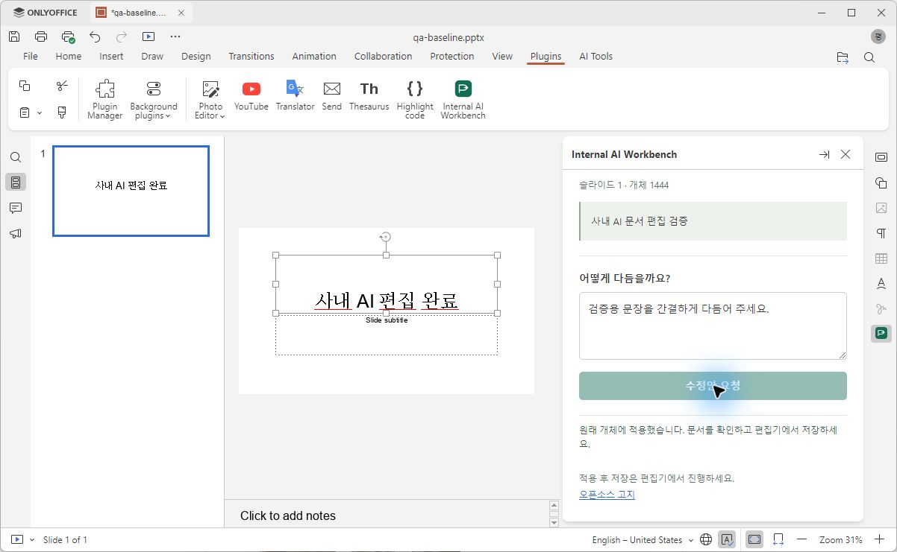
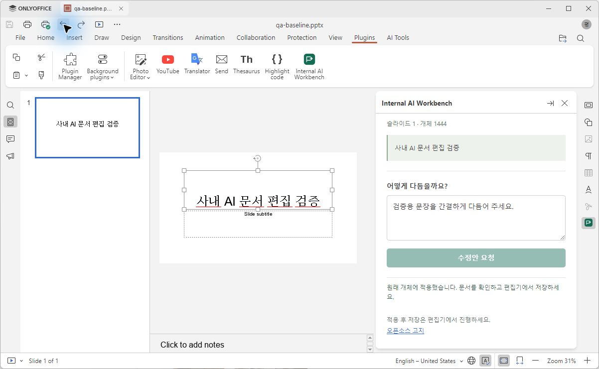
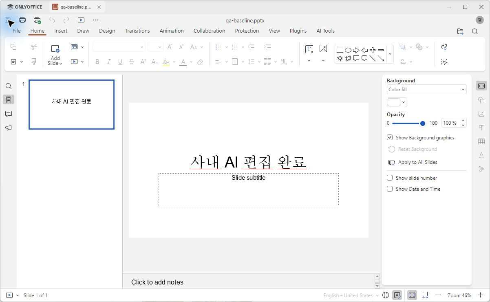

# Desktop PoC 0.2.0 QA 결과

날짜: 2026-10-18 (Asia/Seoul). Windows x64에서 실제 ONLYOFFICE Desktop Editors 10.0.0을 실행했다. 합성 PPTX만 사용했다.

## 기획 범위

PC 설치형 우선 결정에 따라, 첫 번째 실제 엔진 QA는 텍스트 상자 읽기 → 로컬 모의 AI 요청 → 수정안 확인 → 원래 개체 적용 → undo/redo → 저장·재열기로 정했다. 사내 API·Marker·PDF는 이번 검증 대상이 아니다.

## 실행 환경

- 공식 DesktopEditors v10.0.0의 Windows x64 ZIP을 작업 폴더에 압축 해제하여 실행했다. 시스템 설치 프로그램은 실행하지 않았다.
- ZIP SHA-256: `54979d04f1cdca56deb0c62e0356355a45f392cdb54f04f6b7e436b1f44c3605`. GitHub release asset digest와 일치.
- DesktopEditors.exe의 Windows Authenticode 서명 상태 `Valid`, 서명자 Ascensio System SIA 확인.
- 플러그인은 사용자 데이터의 `sdkjs-plugins/{A5BA9AF1-7BCE-4B75-86F7-C28D4E922B1B}`에 파일을 복사하는 개발 설치 방식으로 로드했다. `.plugin`을 UI 메뉴로 설치하는 경로는 별도 미검증이다.
- 로컬 서비스 `127.0.0.1:4318`, 합성 pairing token, mock AI. 사내 주소·키·문서는 사용하지 않았다.

## 발견한 문제와 수정

1. **CORS 출처 불일치**: 실제 Windows Desktop 플러그인은 `Origin: file://`로 OPTIONS를 보냈다. 기존 기본값 `null`만으로는 `Failed to fetch`가 발생했다. 기본 허용 출처에 정확한 `file://`를 추가했다. 토큰 인증과 다른 웹 출처 차단은 유지하며, 두 로컬 출처의 preflight·인증 회귀 테스트를 추가했다.
2. **빈 run 포함**: UI에서 한 문단의 일반 문장을 붙여 넣어도 빈 run이 남아 기존 ‘run 개수=1’ 조건에 걸렸다. 모든 요소가 일반 run인지 검사하고, 내용이 있는 run이 정확히 한 개인 경우만 수정하도록 보완했다. 빈 run은 수정하지 않는다. 여러 nonempty run과 다중 문단은 계속 거부한다.

## 결과

| 검증 | 실제 결과 |
| --- | --- |
| 개발 경로 설치·패널 로드 | Plugins 탭에서 플러그인 표시, 우측 패널 정상 |
| localhost 연결 | 수정 후 mock health·proposal 요청 성공 |
| 텍스트 상자 읽기 | ‘사내 AI 문서 편집 검증’과 현재 개체 ID 표시 |
| 수정안 확인·적용 | 미리보기에서 ‘사내 AI 편집 완료’로 확인·편집 후 적용 성공 |
| undo 한 번 | 원문 ‘사내 AI 문서 편집 검증’으로 복구 |
| redo 한 번 | ‘사내 AI 편집 완료’로 복구 |
| 저장·재열기 | 편집기를 닫고 저장 파일을 다시 열어 수정 내용 확인 |
| XML 서식 비교 | a:rPr와 p:spPr 일치. 텍스트·도형 ID를 제외한 첫 슬라이드 XML 일치 |
| 자동 회귀 | `npm test`: 12개 통과, 실패 0 |

도형 ID는 저장 과정에서 변경되었다. 내부 ID는 현재 편집 세션 안에서만 사용하며, 파일 재열기·버전 간 영구 ID로 사용하지 않는다. 전체 문서의 모든 서식 보존을 보장하는 결과는 아니다.







[합성 문서의 XML 비교 결과](assets/desktop-xml-comparison.json)

## 재현

[Desktop 설치 Wiki](../wiki/desktop-setup.md)의 체크리스트를 따른다. 변경 전 합성 파일 사본과 변경 후 닫은 파일을 비교한다.

```powershell
pwsh -File scripts/compare-pptx.ps1 -Original C:\QA\original.pptx -Edited C:\QA\edited.pptx
```

이 스크립트는 첫 슬라이드의 단순 텍스트 검증용이다. 전체 PPTX 패키지·외부 관계·다른 슬라이드 보존 검증을 대체하지 않는다. 사내 문서 원문이나 메타데이터를 출력하지 않도록 결과는 비교 여부만 표시한다.

## 남은 검증

- 실제 사내 LLM과 클라우디움 연동.
- 실제 엔진에서 선택 변경 중 적용·원문 충돌·개체 삭제의 추가 UI 시나리오 (현재 자동 모형 테스트만 통과).
- 복잡한 서식·표·그룹·이미지·PDF, Marker 분석.
- `.plugin` UI 설치, 통합 런처·설치 프로그램, 완전한 인터넷 차단 상태 신규 설치·운영.
- 기존 기본 플러그인·업데이트 등 편집기 자체의 외부 네트워크 의존성 점검. localhost 연결 성공만으로 완전한 폐쇄망 실증을 선언하지 않는다.
