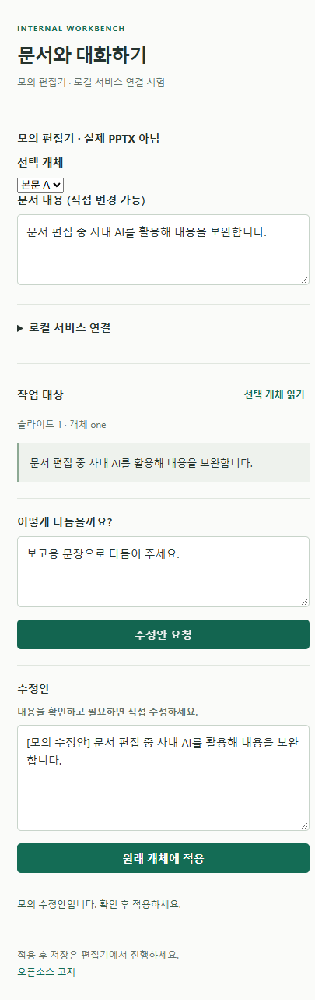

# PoC 0.1.0 QA 결과

날짜: 2026-10-18 (Asia/Seoul). 환경: Windows, Node 22.14.0, npm 10.9.2. 입력: 합성 문장만 사용.

## 자동 검증

`npm test`: **11개 통과**, 0 실패. Node 기본 test runner 사용, 외부 npm 의존성 없음.

- 원래 개체 ID 유지: 선택을 다른 개체로 바꿔도 원래 대상만 변경 (Office API 모형).
- 원문 변경/삭제, 다중 run/문단, 빈/여러 줄/과도한 수정안 차단 (Office API 모형).
- 기본 mock 모드에서 upstream 호출 없음.
- pairing token, Origin, Host 검사와 null Origin preflight.
- 잘못된 JSON·작업 종류·입력 길이·본문 크기·Content-Type 거부.
- OpenAI 호환 요청 형식과 키 비노출 (실제 내부 LLM 대신 모의 Response).
- upstream 오류·빈/여러 줄 응답 거부.
- 정적 경로 제한: .env, private/runtime.json, 서버 소스 제공 차단.

초기 Host 위조 테스트는 Node fetch가 Host를 재작성하여 실패했다. raw http 요청으로 바꾸어 실제 위조 Host가 403인지 검증했다.

## 브라우저 모의 UI 점검

Playwright CLI로 실제 브라우저에서 로컬 서비스와 연결해 다음을 확인했다.

1. 연결 코드 입력 → mock 연결 확인.
2. 본문 A 읽기 → 요청 → 수정안 미리보기.
3. 본문 B로 선택 변경 → 적용 → B 원문 유지, A만 모의 수정안으로 변경.
4. A를 다시 읽고 요청한 뒤 원문을 직접 변경 → 적용 거부, 변경한 원문 유지.
5. 420px 폭에서 줄바꿈·입력창·버튼·오류 문구를 화면으로 확인.

첫 로드에서 favicon 404가 있어 로컬 SVG favicon 링크를 추가했다. 수정 후 리로드와 mock 요청까지 브라우저 콘솔 오류·경고 0건, 관찰된 네트워크 요청 10건 모두 127.0.0.1이며 200 응답임을 확인했다. 이는 관찰한 모의 UI 흐름에 한정한 결과다.

## 패키지 검증

`npm run package`로 `.plugin`, 소스 ZIP과 SHA-256 목록을 생성했다. Windows의 독립 ZIP reader로 각 파일을 읽어 원본 바이트와 비교하고, 재빌드의 해시 일치 여부를 확인했다. 이 검사는 실제 Desktop Editors 설치 성공을 의미하지 않는다.

## 이번 검증으로 증명하지 않은 사항

- 실제 ONLYOFFICE Desktop Editors 10.0.0 설치·플러그인 로딩·Origin·callCommand 실행.
- 실제 PPTX 파일 편집·서식 보존·undo·저장·재열기.
- PDF, 다중 서식, 표, 이미지, 그룹, 부분 문자열 수정.
- 실제 사내 LLM, 클라우디움, Marker 실행.
- 전체 PC 설치 프로그램 및 완전한 인터넷 차단 환경 배포.

이 항목들은 실제 엔진과 사내 API가 있는 환경에서 다음 QA로 진행한다.
